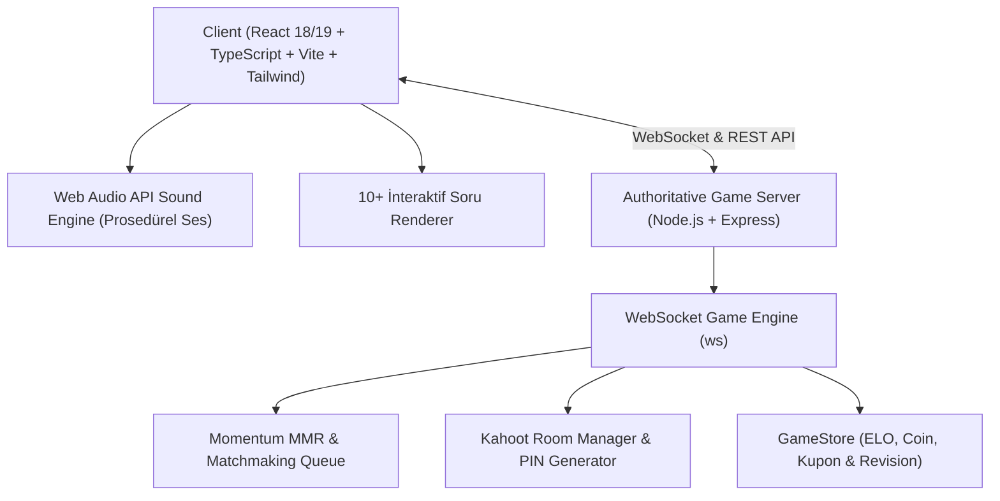

# 🔥 Gauss Arena
### *İşler Hackathon '26 • EdTech Game Jam Projesi*

[](https://nodejs.org/)
[](https://react.dev/)
[](https://www.typescriptlang.org/)
[](https://tailwindcss.com/)
[](tests/)
[](#-100-telifsiz-prosedürel-web-audio-ses-motoru)

---

## 👥 Geliştirici Ekip

| Geliştirici | Rol & Sorumluluk Alanı | İletişim  |
| :--- | :--- | :--- |
| 👨‍💻 **Enes Ersoy** | **Full-Stack & WebSocket Mimarı** | [GitHub](https://github.com/enesersoy134) |
| 🎨 **Kerim Onur Tunç** | **UI/UX & Frontend Mimarı** | [GitHub](https://github.com/kerimonurtunc) |

---

## 🎯 Vizyon ve Proje Özeti

Türkiye'de her yıl **milyonlarca öğrenci** LGS, TYT ve AYT sınavlarına hazırlanmaktadır. Ancak klasik test çözümü **konuyu kavrayamamaya**, **bıkkınlığa** ve **ezberlese bile bilgileri uygulamakta zorlanmaya** yol açmaktadır.

**Gauss Arena **; klasik çoktan seçmeli A-B-C-D-E testlerini:
1. **Canlı 1v1 düellolar**,
2. **Kavramı deneyerek öğreten Başlangıç Mini Oyunlarına**,
3. ** Akıllı Tahta ikili Takım Kapışmalarına (`/tahta`)**,
4. **Tüm sınıfın telefonlarıyla katıldığı QR Canlı Sınıf Yarışmalarına (`/katil`)**,
5. **Kazanım bazlı Yüzdesel Eksik Analizi (`Revision`) ve Kaynak Önerilerine**

dönüştüren bütünsel ve yeni nesil bir **EdTech Oyunlaştırma Ekosistemidir**.

---

## ✨ Temel Özellikler ve Modüller

### 1. ⚔️ Momentum Tabanlı Efektif MMR & Canlı 1v1 Düello
- **Momentum Formülü:** $MMR_{eff} = ELO + \text{sign}(S) \cdot \min(|S|-2, 6) \cdot 35$ *(S = Seri Galibiyet/Mağlubiyet)*.
- **Smurf Kalkanı:** Arka arkaya maç kazanan başarılı oyuncuları hızla üst liglere taşır, yeni başlayanları korur.
- **Dinamik Bar:** İki oyuncunun anlık doğruluk ve hız farkına göre dinamik olarak sağa/sola kayan canlı enerji üstünlük barı.
- **Haftalık 15 Maç Barajı & Kupon Sadakat Modeli:** Haftalık coin ödülünü almak için 15 maç yapma şartı.

### 2. 🧪 10+ Zengin İnteraktif Soru Mekaniği (40+ Kazanım Havuzu)
Klasik testlerin ötesine geçen dokunmatik ve analitik mekanikler:
- `StepperBalance`: Kimyasal tepkime katsayılarını artı/eksi butonlarıyla dengeleme.
- `MatrixToggle`: Mantık & özellik tablosu.
- `SliderEstimate`: Fiziksel büyüklükleri ve sayısal değerleri tolerans aralığında kaydırarak tahmin etme.
- `TapToHighlight`: Paragrafta anlatım bozukluğu veya ana fikri dokunarak vurgulama.
- `PairMatching`: Biyoloji ve kimya kavramlarını kartlarla eşleştirme.
- `SwipeGrouping`: Sağa/sola kaydırarak asit-baz veya canlı gruplarını sınıflandırma.
- `DragDropLab`: Deney tüplerini ve düzenekleri sürükleyip bırakarak reaksiyon oluşturma.
- `OrderingAndFormula`: Tarihsel olayları veya formül adımlarını kronolojik sıraya dizme.
- `ChainConversion` & `MultiSelectBubble`: Çoklu kazanım doğrulaması.
- **Sınav Kademeleri:** `LGS`, `TYT`, `AYT`.
- **Seviye Motoru:** `Adaptif`, `Kolay`, `Orta` ve `Zor`.

### 3. 🎯 Bireysel Alıştırma Modu & Eğitsel Mini Oyunlar
- **Bireysel Soru Alıştırması:** Multiplayer süre baskısı olmadan 5, 10 veya 15 soruluk kişisel antrenman. Ekranın en altına sabitlenen (`fixed bottom-0`) responsive aksiyon barı ile tek tıkla ilerleme.
- **Learn-Before-Compete:** 1v1 lige girmeden önce temel kavramların keşfedildiği 6 branşta interaktif mini oyun (Kimya Molekül Sentezi, Fizik Vektör Dengeleme, Türkçe Rap Battle, vb.).

### 4. 🖥️ Akıllı Tahta 2 Takım Modu (`/tahta`) & Anti-Cheat Gizlilik Kalkanı
- **Asimetrik Şık Karıştırma:** Sol Takım (Mavi) ve Sağ Takım (Turuncu) için şıkların yerleri bağımsız karıştırılır; göz ucuyla bakarak kopya çekilemez.
- **Bulanıklaştırma (Blur) Kalkanı:** Bir takım butona bastığı anda o takımın alanı anında `backdrop-blur-xl` ile maskelenir ve rakibin cevabı görmesi engellenir.

### 5. 📱 QR Kodlu Canlı Sınıf Yarışması (`/katil`) & Sınıf Eksik Raporu
- Akıllı tahtada beliren QR kod veya 6 haneli PIN ile tüm sınıf telefonlarıyla anında katılır.
- Süre bitene kadar telefon ekranında doğru şık gizlenir.
- Yarışma bittiğinde sınıfın en çok yanlış yaptığı kazanımlar yüzdesel olarak raporlanır (Örn: *Hücre Bölünmeleri %75 Eksik*) ve doğrudan ilgili konu kitabı tavsiye edilir.

### 6. 📚 Eksik Konu Analizi (`Revision`) & O2O Kitap Dönüşümü
- Düellolarda yanlış yapılan sorular veritabanında konu başlığıyla işlenir.
- **"🔀 Yanlışlarımı Karışık Çöz":** Sadece eksik olunan konulardan oluşan telafi antrenmanı.

### 7. 🎹 %100 Telifsiz Prosedürel Web Audio Ses Motoru
- **Sıfır Harici MP3 / WAV Bağımlılığı:** Jüri telif güvenliği gereği harici dosya kullanılmaz.
- Tarayıcının yerel **Web Audio API** osilatör ve filtreleriyle gerçek zamanlı sentezlenen 9 özgün ses efekti (Doğru, Yanlış, Zafer Fanfarı, Combo 3x/5x, Halat Çekme, Sayaç Tik) ve lobi/arena fon müziği.

---

## 🌐 Uygulama Rotaları (Routes)

| Rota | Açıklama |
| :--- | :--- |
| **`/`** | **Ana Arena:** 1v1 Dereceli Düello, Bireysel Alıştırma, Haftalık Lig Tablosu ve Kupon Mağazası |
| **`/random`** | **Hızlı Jüri Girişi:** Tek tıkla otomatik benzersiz ELO, lig ve avatara sahip rastgele öğrenci hesabı açar |
| **`/p1` & `/p2`** | **Hızlı Canlı Düello:** İki ayrı telefondan veya pencereden anında karşılıklı maç başlatma linkleri |
| **`/tahta`** | **Akıllı Tahta Modu:** Sınıf içi 2 takım split-screen kopya korumalı tahta kapışması |
| **`/katil`** | **Öğrenci Telefon Arayüzü:** QR kod veya 6 haneli PIN ile sınıftaki canlı yarışmaya katılma ekranı |
| **`/admin`** | **Yönetim & Simülasyon Paneli:** 15 maç simülasyonu, lig ödülleri dağıtımı, soru bankası test aracı |

---

## 🎨 Tasarım Dili 

- **Arena Dark:** `#150A16` (Odaklanmayı artıran koyu zemin)
- **Surface Glass:** `#1A0E1C` (Yarı saydam cam efektli kartlar)
- **İşler Turuncusu:** `#F14E13` (Dinamik marka kimliği ve aksiyon rengi)
- **Rakip Mavisi:** `#3B82F6` | **Başarı Yeşili:** `#22C55E` | **Combo Moru:** `#A855F7`
- **Tipografi:**
  - `Poppins` (Enerjik Başlıklar)
  - `Source Sans 3` (Yüksek Okunabilirlikli Soru Gövdesi)
  - `JetBrains Mono` (Bilimsel Formüller, Sayaçlar ve Canlı Skorlar)

---

## 🛠️ Teknik Mimari



---

## 💻 Kurulum ve Çalıştırma Talimatları

### 1. Gereksinimler
- **Node.js:** v18.0.0 veya üzeri
- **Python:** v3.10+ 

### 2. Yükleme
```bash
npm install
```

### 3. Geliştirme Modunda Çalıştırma

**Terminal 1 — Backend Sunucusu (`http://localhost:3000`):**
```bash
npm run dev:server
```

**Terminal 2 — Frontend Uygulaması (`http://localhost:5173`):**
```bash
npm run dev:client
```

### 4. Tek Komutla Production Build & Çalıştırma
```bash
npm run build
npm start
```
*Uygulama `http://localhost:3000` adresinde optimize edilmiş statik dosyalar ve WebSocket motoruyla canlıya alınır.*


## 🏆 Lisans ve Haklar

Bu proje **İşler Hackathon '26** kapsamında geliştirilmiştir. Kullanılan tüm arayüz bileşenleri, soru tipleri, ses sentezleme motoru ve algoritmalar özgün ve telifsizdir.
